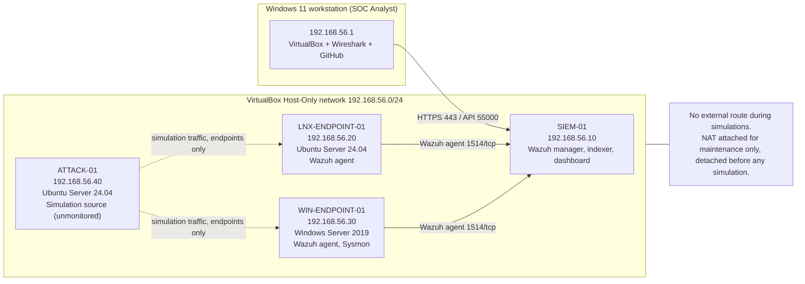

# Lab Topology

Rendered on GitHub from the Mermaid source below. To regenerate a PNG, paste
the same source into mermaid.live.

Legend

    Solid line: lab monitoring traffic.

    Dashed line: simulation traffic.

    The note records the isolation constraint from
    docs/policies/lab-safety.md
